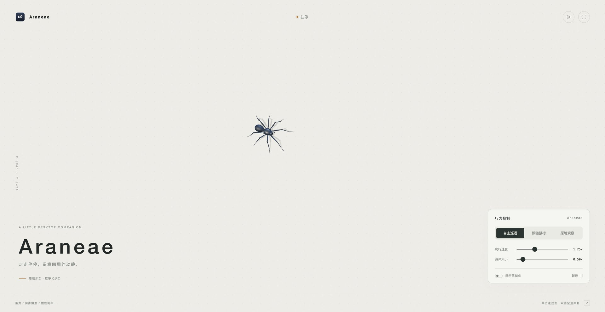

# Araneae

English | [简体中文](README.zh-CN.md)

**[Try the browser demo](https://jaaasonho.github.io/Araneae/)** — no installation required. The demo runs inside your browser tab; desktop overlays and cross-display movement require the macOS app.



The macOS desktop companion stays visible over other apps, as shown here over Google Translate:


A spider desktop companion that walks, watches, and dashes across your screen. Built with **Tauri 2 + Three.js**, its body, eight legs, eyes, and fine hairs are generated in code, with no external models required.

The desktop companion currently targets **macOS 12 and later**. The current build has been verified on an Apple Silicon Mac; desktop support on Intel Macs, Windows, and Linux has not been verified. The project also includes a standalone browser version.

## Features

- Procedural anatomy, an eight-legged grounded gait, head and body observation gestures, momentum-based braking, skid marks, and dust.
- Three behavior modes: autonomous patrol, follow the pointer, and observe in place.
- A transparent floating window that lets mouse input pass through by default, with support for regular desktops and fullscreen application spaces.
- Routes between connected displays, including horizontal, vertical, and staggered arrangements.
- An option to restrict patrol, following, and manual commands to the current display.
- Adjustable speed and size, plus pause and hide controls. Continuous rendering stops while paused or hidden.
- No internet connection required at runtime. Three.js is bundled with the source.

## App Size and Resource Usage

The local **macOS arm64 app bundle is approximately 8.9 MiB** (9,327,831 bytes, measured on November 24, 2026). This is the sum of file sizes inside `Araneae.app`, not its runtime memory usage or a published ZIP/DMG download size. Build options, architecture, and future changes may affect the size.

The animated 3D companion uses CPU, GPU, and memory while active. A small app bundle does not imply negligible runtime cost:

- When checking resource usage, include the main app and its WebKit WebContent, graphics/media, and networking processes.
- Usage varies with behavior mode, display configuration, scaling, and hardware. Earlier short measurements do not establish a benchmark for the current version; no fixed CPU or memory target is claimed.
- Pause or hide the companion to stop continuous rendering. This reduces ongoing rendering work but does not quit the app or release all of its memory.

## Using the Desktop Companion

After building from source, drag `Araneae.app` into Applications and open it. If you download a separately provided prebuilt app, make sure its processor architecture matches your Mac. The source repository does not include a compiled app.

On launch, the spider appears on your screen, accompanied by a small eyes icon in the menu bar. The app stays out of the Dock and keeps the control panel closed until you open it from the menu bar. The desktop interface follows the system’s preferred language at launch: Chinese uses Simplified Chinese, and other languages use English. This applies to the menu bar, control panel, window titles, and messages. Restart the app after changing your system language.

| Action | Result |
| --- | --- |
| Choose a mode from the menu bar or panel | Autonomous patrol, follow the pointer, or observe in place |
| ⌘ Command + click | Temporarily dash toward the destination at up to 3× speed; click again to change the destination |
| Turn off Allow Cross-Display Movement | Stay on the spider’s current display and ignore Command-clicks on other displays |
| Pause / hide | Stop continuous rendering and ignore movement commands |
| Press Space in the control panel | Pause / resume |

A manual dash preserves the selected behavior mode. In observe mode, the spider resumes observing at its new location after arrival. Changing modes during a dash cancels the manual route. Regular clicks and double-clicks do not command the desktop pet, and mouse events still reach the original application. Clicks inside the control panel or menus do not command the pet.

Speed ranges from **0.35× to 3.00×**, with a default of **1.25×**. Size ranges from **0.35× to 2.10×**, with a default of **0.50×**. Cross-display movement is enabled by default. Settings are currently kept in memory and are not saved after quitting.

### Multiple Displays and Known Limitations

- Display positions follow the arrangement in macOS System Settings → Displays. Displays must share an edge for crossing; mirrored displays are treated as one area.
- Coordinates use macOS logical points. The layout updates when displays are connected, disconnected, or rearranged. If the current display is removed, the spider is recovered onto a visible display.
- Disabling cross-display movement cancels the existing route and restricts the spider to its current display. Re-enabling it restores crossing.
- Destinations avoid the menu bar and Dock and leave room for the body at screen edges. An edge click does not guarantee that the body’s center lands exactly under the pointer.
- Coverage is not guaranteed on the lock screen or system-protected interfaces. Fullscreen and multi-display behavior may vary with the macOS version and display configuration.
- The current build uses an ad hoc signature and is not notarized by Apple. Other Macs may show a security prompt.

### Mouse Events and Privacy

On macOS, a global mouse event monitor detects Command-clicks in other applications. It handles only left-button presses, releases, and drags, along with the Command modifier carried by those mouse events. It does not monitor keyboard input in other applications or consume mouse events. The current code includes no telemetry, account login, or data upload functionality.

## Running from Source

### Browser Version

Requires Node.js 18 or later. No `npm install` or frontend build is needed:

```bash
npm run dev
```

Open **http://127.0.0.1:4173/**. Do not open `dist/index.html` directly: ES Modules must be served over HTTP. You can also deploy `dist/` as a static site.

If the port is in use, run `PORT=4174 npm run dev` on macOS / Linux, or `$env:PORT=4174; npm run dev` in PowerShell.

Browser controls differ from the desktop companion: **click to move, double-click to dash, and Space to pause**. The browser version also retains light/dark backgrounds and fullscreen controls. Its interface remains in Simplified Chinese. Cross-display movement, Command-click commands, and automatic interface language selection belong to the macOS desktop companion.

### macOS Desktop Companion

Requires Node.js 18+, Rust, Xcode Command Line Tools, and Tauri CLI 2. The current successful build used Rust **1.91.1**. Rust dependency versions are pinned in `src-tauri/Cargo.lock`.

```bash
xcode-select --install
cargo install tauri-cli --version '^2' --locked
npm run desktop:dev
```

Skip the corresponding installation commands if Xcode Command Line Tools or Tauri CLI is already installed. The first build needs an internet connection to download dependencies; builds can run offline once the cache is complete.

Build an app for the architecture of the current Mac:

```bash
npm run desktop:build
```

The app is generated at:

```text
src-tauri/target/release/bundle/macos/Araneae.app
```

With a complete dependency cache, use `CARGO_NET_OFFLINE=true npm run desktop:build`. The current build configuration does not perform Apple notarization, and there is no automatic updater.

## Development and Checks

| Path | Responsibility |
| --- | --- |
| `dist/app.js` | Scene, interaction, and motion loop |
| `dist/organic.js` | Appearance, materials, fine hairs, and fallback rendering |
| `dist/motion.js` | Acceleration, dashing, braking, and body poses |
| `dist/gait.js`, `dist/leg-safety.js` | Eight-legged gait, support constraints, and leg clearance |
| `dist/patrol.js`, `dist/skid-effects.js` | Patrol, observation, and braking effects |
| `dist/desktop*.js` | Desktop coordinates, routing, cropping, clock, and settings adaptation |
| `dist/controls.html`, `dist/controls.js` | Desktop control panel |
| `src-tauri/src/` | Native windows, menu bar, mouse monitoring, and settings |
| `scripts/` | Motion, routing, and clock checks |
| `server.mjs` | Local static server |

JavaScript syntax checks:

```bash
npm run check
```

Choose simulation checks according to the scope of your changes:

```bash
npm run test:gait
npm run test:burst
npm run test:inertia
npm run test:anchor
npm run test:patrol
npm run test:sprint
```

Native and desktop checks on macOS:

```bash
npm run desktop:check
npm run desktop:test
```

Simulation checks cover gait, momentum, anchored recovery, patrol, dashing, and desktop routing rules. They do not replace visual, fullscreen, or multi-display testing on a real Mac.

The **Windows CI** workflow runs JavaScript syntax checks, Rust formatting, scoped desktop routing/clock/cropping tests, and native compilation and tests on `windows-latest`. The included `src-tauri/icons/icon.ico` is required by Tauri's Windows resource compiler. This workflow does not provide Windows desktop functionality, build installers, or publish releases. The full desktop motion simulation is not included: it currently fails on the unchanged baseline at `manual-horizontal-slow: patrol took over a manual destination`; `npm run desktop:test` retains that check.

Issues and improvements are welcome. Please include your macOS version, Mac chip, display arrangement and scaling, behavior mode, and reproduction steps. Keep the browser and desktop behavior boundaries intact, and avoid unrelated refactoring.

## License and Third-Party Code

This project is released under the [MIT License](LICENSE), with copyright attributed to [jaaasonho](https://github.com/jaaasonho).

The bundled Three.js r170 is copyrighted by the Three.js authors and distributed under the MIT License. See [THREE-LICENSE.txt](dist/assets/THREE-LICENSE.txt) for the full notice. Rust dependencies retain their own licenses; their versions are listed in `src-tauri/Cargo.lock`. This project’s MIT License does not replace third-party licenses.
