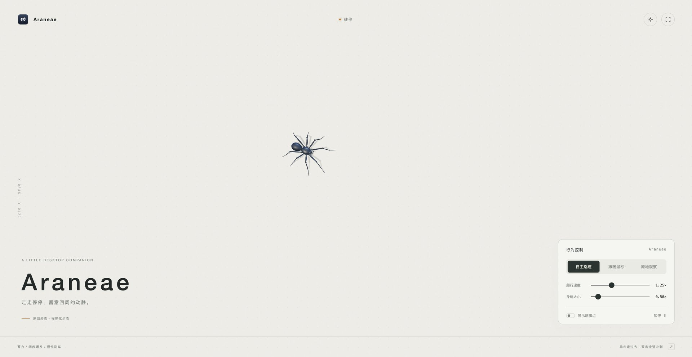

# Araneae

[English](README.md) | 简体中文

**[在线体验网页版](https://jaaasonho.github.io/Araneae/)** — 无需安装。演示在浏览器标签页内运行；桌面悬浮和跨屏移动需要 macOS App。



macOS 桌宠可以悬浮在其他应用上方，下面是它在 Google 翻译页面上的效果：


一个在屏幕上散步、观察和冲刺的蜘蛛桌宠。使用 **Tauri 2 + Three.js**，身体、八条腿、眼睛和细毛由代码生成，无需外部模型。

桌宠目前面向 **macOS 12 及以上版本**，当前构建在 Apple Silicon Mac 上验证过；Intel Mac、Windows 和 Linux 桌宠尚未验证。项目同时保留可在浏览器中独立运行的网页版。

## 特点

- 程序化外形、八足抓地步态、头身观望、惯性刹车、滑痕与浮尘。
- 自主巡逻、跟随鼠标、原地观察三种模式。
- 透明悬浮，默认鼠标穿透；支持普通桌面和全屏应用空间。
- 按显示器排列规划跨屏路线，支持左右、上下及错位相接的屏幕。
- 可关闭跨屏，将巡逻、跟随及手动指令限定在当前屏幕。
- 可调整速度、体型，支持暂停和隐藏；暂停或隐藏后停止持续绘制。
- 应用运行无需联网，Three.js 随源码附带。

## 应用体积与资源占用

本地 **macOS arm64 App 约 8.9 MiB**（9,327,831 字节，测量于 2026 年 11 月 24 日）。该数值为 `Araneae.app` 内文件大小之和，不是运行内存，也不是已发布 ZIP/DMG 的下载体积。构建选项、架构及后续改动可能影响体积。

三维桌宠在活动时会持续使用 CPU、GPU 和内存，安装包小并不意味着运行开销可以忽略：

- 查看资源占用时，需要包含主进程及关联的 WebKit 网页内容、图形/媒体和网络进程。
- 占用会随行为模式、显示器配置、缩放及硬件变化。此前的短时测量不能作为当前版本的性能基准，项目暂不承诺固定的 CPU 或内存指标。
- 暂停或隐藏可停止持续绘制、减少渲染工作，但不会退出应用或释放全部内存。

## 使用桌宠

从源码构建后，将 `Araneae.app` 拖入「应用程序」并打开。若另行下载了预编译 App，需确认其处理器架构与自己的 Mac 相符。仓库源码不包含编译后的 App。

应用启动后只显示蜘蛛和菜单栏的小眼睛图标，不自动打开控制面板，也不占用 Dock。从菜单栏打开「控制面板」即可调整设置。桌宠界面在启动时跟随系统首选语言：中文使用简体中文，其他语言使用英文，覆盖菜单栏、控制面板、窗口标题和提示消息。修改系统语言后需重启应用。

| 操作 | 效果 |
| --- | --- |
| 菜单栏或面板选择行为模式 | 自主巡逻、跟随鼠标或原地观察 |
| ⌘ Command + 单击 | 临时以最高 3× 速度冲刺前往；再次点击可改换目的地 |
| 关闭「允许跨屏」 | 留在蜘蛛当前所在屏幕，忽略其他屏幕的 Command + 单击 |
| 暂停 / 隐藏 | 停止持续绘制，并忽略移动指令 |
| 在控制面板内按空格 | 暂停 / 继续 |

手动冲刺不改变已选模式：原地观察时，冲刺到达后会继续在新位置观察。途中切换模式则取消手动路线。普通单击、双击不指挥桌宠，鼠标事件仍传递给原应用；控制面板和菜单内的点击不指挥桌宠。

速度范围为 **0.35×–3.00×**，默认 **1.25×**；体型范围为 **0.35×–2.10×**，默认 **0.50×**。「允许跨屏」默认开启。当前设置保存在内存中，退出后不会保存。

### 多屏与已知限制

- 显示器位置遵循 macOS「系统设置 → 显示器 → 排列」。跨屏需要屏幕边缘相接；镜像屏幕视为同一个区域。
- 使用 macOS 逻辑点统一坐标。显示器拔插或排列变化后自动更新；当前屏幕被移除时，蜘蛛会恢复到可见屏幕上。
- 关闭跨屏时会取消原路线，并限定在当前屏幕；重新开启后恢复跨屏能力。
- 目的地避开菜单栏和 Dock，并在屏幕边缘保留身体空间；边缘点击不保证身体中心精确落在指针位置。
- 锁屏和系统保护界面不保证覆盖。全屏及多屏表现仍可能受系统版本和显示器配置影响。
- 当前构建使用本地临时签名，未进行 Apple 公证，其他 Mac 可能遇到系统安全提示。

### 鼠标事件与隐私

macOS 桌宠通过全局鼠标事件监听器识别其他应用中的 Command + 单击，仅处理左键按下、抬起和拖动，以及这些鼠标事件携带的 Command 状态；不监听其他应用的键盘输入，不吞掉鼠标事件。当前代码没有加入遥测、账号登录或数据上传功能。

## 从源码运行

### 网页版

需要 Node.js 18 或以上版本。不需要 `npm install` 或前端构建：

```bash
npm run dev
```

打开 **http://127.0.0.1:4173/**。不要直接双击 `dist/index.html`，ES Module 需要通过 HTTP 服务加载。也可以将 `dist/` 部署为静态站点。

端口冲突时，macOS / Linux 可运行 `PORT=4174 npm run dev`；PowerShell 可运行 `$env:PORT=4174; npm run dev`。

网页版的操作与桌宠不同：**单击前往、双击冲刺、空格暂停**，并保留深浅背景和全屏控件，界面仍为简体中文。跨屏、Command + 单击及自动选择界面语言属于 macOS 桌宠功能。

### Windows 桌面版

需要 Node.js 18+、Rust MSVC 工具链、Visual Studio Build Tools（勾选「使用 C++ 的桌面开发」）以及 Microsoft Edge WebView2 运行时。

```powershell
cargo install tauri-cli --version "^2" --locked
npm.cmd run desktop:dev
```

`npm.cmd run desktop:build`

按住 Ctrl 并单击鼠标左键可指定冲刺目标。安装包输出目录为 `src-tauri/target/release/bundle/nsis/`.

### macOS 桌宠

需要 Node.js 18+、Rust、Xcode Command Line Tools 和 Tauri CLI 2。当前成功构建使用 Rust **1.91.1**，Rust 依赖版本由 `src-tauri/Cargo.lock` 固定。

```bash
xcode-select --install
cargo install tauri-cli --version '^2' --locked
npm run desktop:dev
```

已安装 Xcode Command Line Tools 或 Tauri CLI 时，可跳过对应安装命令。首次构建需要联网下载依赖，缓存完整后可离线构建。

生成当前 Mac 架构的 App：

```bash
npm run desktop:build
```

产物位置：

```text
src-tauri/target/release/bundle/macos/Araneae.app
```

缓存完整时可使用 `CARGO_NET_OFFLINE=true npm run desktop:build`。当前构建配置不执行 Apple 公证，也没有自动更新功能。

## 开发与检查

| 路径 | 职责 |
| --- | --- |
| `dist/app.js` | 场景、交互和运动循环 |
| `dist/organic.js` | 外形、材质、细毛和兼容绘制 |
| `dist/motion.js` | 加减速、冲刺、刹车和身体姿态 |
| `dist/gait.js`、`dist/leg-safety.js` | 八足步态、支撑约束和腿段避让 |
| `dist/patrol.js`、`dist/skid-effects.js` | 巡逻、观望和刹车效果 |
| `dist/desktop*.js` | 桌面坐标、导航、裁剪、时钟和设置适配 |
| `dist/controls.html`、`dist/controls.js` | 桌宠控制面板 |
| `src-tauri/src/` | 原生窗口、菜单栏、鼠标监听和设置 |
| `scripts/` | 运动、导航和时钟检查 |
| `server.mjs` | 本地静态服务器 |

JavaScript 语法检查：

```bash
npm run check
```

按改动范围选择模拟检查：

```bash
npm run test:gait
npm run test:burst
npm run test:inertia
npm run test:anchor
npm run test:patrol
npm run test:sprint
```

macOS 原生与桌面检查：

```bash
npm run desktop:check
npm run desktop:test
```

模拟检查覆盖步态、惯性、锚定回正、巡逻、冲刺及桌面导航等规则，不能替代实际 Mac 上的视觉、全屏及多屏测试。

欢迎提交问题与改进。反馈请附 macOS 版本、Mac 芯片、显示器排列与缩放、行为模式及复现步骤；修改时尽量保持网页版与桌宠入口的行为边界，并避免无关重构。

## 许可证与第三方代码

项目采用 [MIT 许可证](LICENSE)，版权署名为 [jaaasonho](https://github.com/jaaasonho)。

随源码附带的 Three.js r170 由 Three.js 作者持有版权，采用 MIT 许可，完整声明见 [THREE-LICENSE.txt](dist/assets/THREE-LICENSE.txt)。Rust 依赖保留各自的许可证，版本可在 `src-tauri/Cargo.lock` 中查询；项目的 MIT 许可不替代第三方许可。
